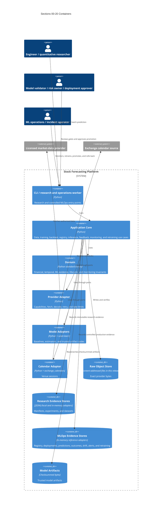

# C4 — Containers

The MLOps evidence stores are intentionally in-memory reference adapters in this release. A
production deployment must replace them with transactional, durable implementations before
multi-process operation.
