# Data Lineage — Sections 00–20

```mermaid
flowchart LR
  Provider[Provider adapter] --> Raw[SHA-256 raw object]
  Raw --> Validation[Versioned validation report]
  Validation -->|accepted| Bars[Append-only point-in-time bars]
  Bars --> Features[Versioned feature snapshot]
  Bars --> Labels[Versioned future label]
  Features --> Dataset[Immutable dataset snapshot]
  Labels --> Dataset
  Dataset --> Split[Fingerprint-addressed split plan]
  Split --> Trials[Candidate fold trials]
  Dataset --> Trials
  Trials --> Selection[Selected candidate]
  Selection --> Holdout[One final holdout evaluation]
  Holdout --> Card[Model card]
  Selection --> Artifact[Checksummed model artifact]
  Artifact --> Candidate[Governed registry candidate]
  Card --> Candidate
  Candidate --> Deployment[Shadow/canary/active deployment]
  Deployment --> Predictions[Immutable prediction batches]
  Features --> Predictions
  Predictions --> Outcomes[Append-only outcome revisions]
  Labels --> Outcomes
  Outcomes --> Feedback[Feedback summary]
  Feedback --> Monitoring[Drift and performance evidence]
  Monitoring --> Retraining[Durable retraining request]
  Retraining --> Trials
  Monitoring --> Rollback[Degradation and rollback evidence]
```

## Required lineage

- Every normalized bar retains provider identity, provider record/revision, raw digest, page and
  row location, information timeline, normalization instant, and superseded identity.
- Every feature observation retains the exact source bar IDs it used.
- Every label retains target version, cutoff, availability, target bars, and benchmark or peer
  bars when applicable.
- Every dataset row retains feature snapshot and label identities and fingerprints.
- Every split plan binds to one dataset version and records all train, validation, purged,
  embargoed, development, and holdout indices.
- Every trial binds to a model specification, fold scores, metric direction, and failure reason.
- Every model card and artifact binds to the dataset and split fingerprints.
- Every model-registry transition binds to actor, reason, lifecycle state, and evidence.
- Every deployment binds to scope, model version, mode, predecessor, status, and time.
- Every prediction binds to the champion, artifact, signature, feature snapshot, input
  fingerprint, decision cutoff, and target horizon before the outcome is available.
- Every outcome revision binds to the source label and prior outcome revision without erasing
  history.
- Every feedback, drift, alert, retraining, promotion, and rollback record retains its input
  evidence references.
- Every backtest fill binds to instrument, session, signal, reference price, execution price,
  quantity, and cost evidence.
