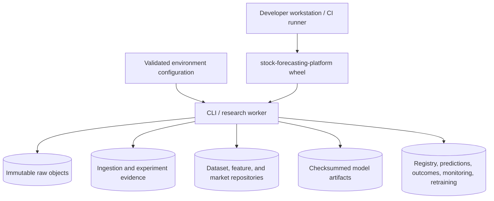

# Deployment Baseline

Sections 00–20 run as one installable Python package. Local execution may use one CLI or worker
process plus local content-addressed storage. This is a research and validation topology, not
the final production deployment.

## Production separation candidates

Later deployment sections may separate:

- market-data ingestion and quality workers;
- feature and dataset materialization workers;
- CPU/GPU training workers;
- batch inference workers;
- outcome collection and monitoring workers;
- API and dashboard processes;
- durable model registry, prediction/outcome ledgers, and monitoring stores.

A split requires evidence for independent scaling, security, availability, change cadence, or
team ownership. The paper-backtesting module remains isolated from broker connectivity.
