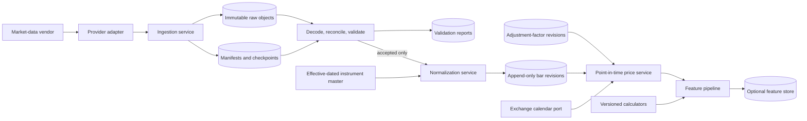
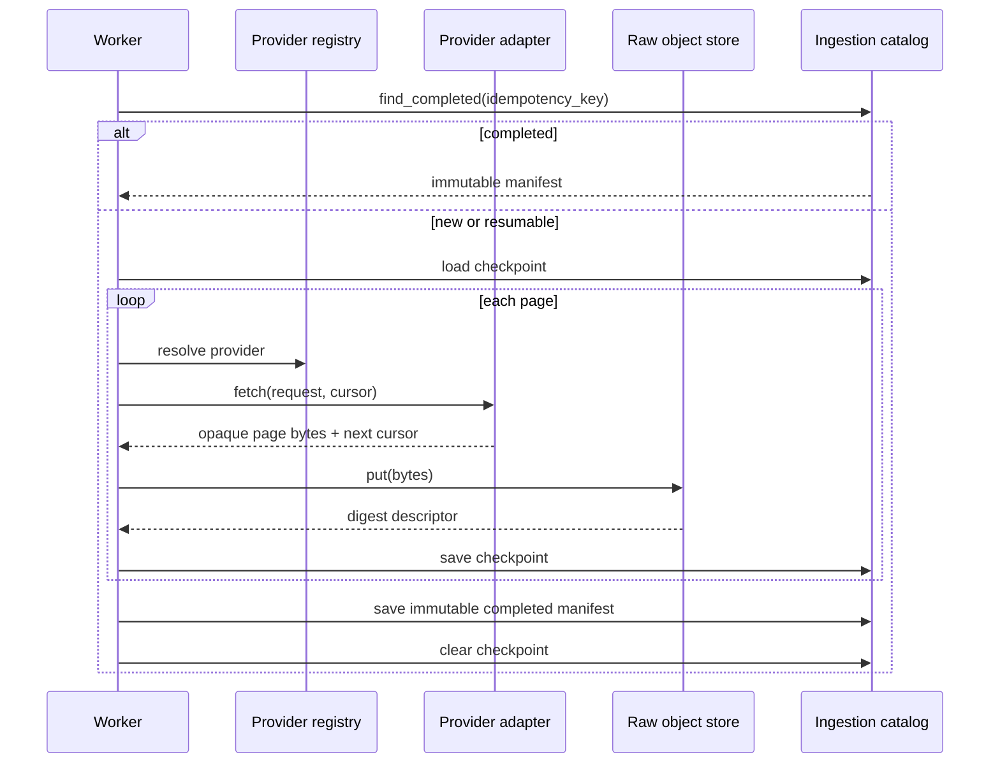
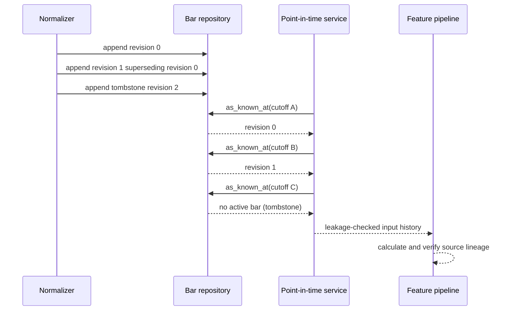

# Market Data and Feature Architecture

## Component Flow

## Ingestion Sequence

## Correction and Cutoff Semantics

## Trust Boundaries

- Provider payloads are untrusted until checksum verification, schema decoding, and quality
  validation complete.
- Validation never changes source bytes.
- Normalization accepts only reports in an accepted state.
- Feature calculators receive domain-owned decimal views, not provider objects or raw JSON.
- A feature snapshot is identified by feature-set version, instrument, as-of date, decision
  cutoff, and input fingerprint.
