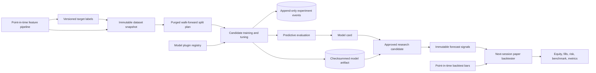
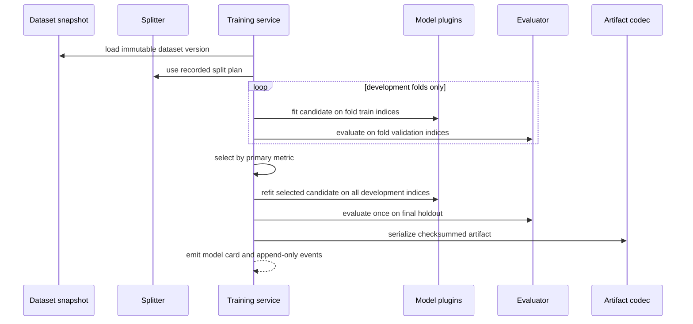
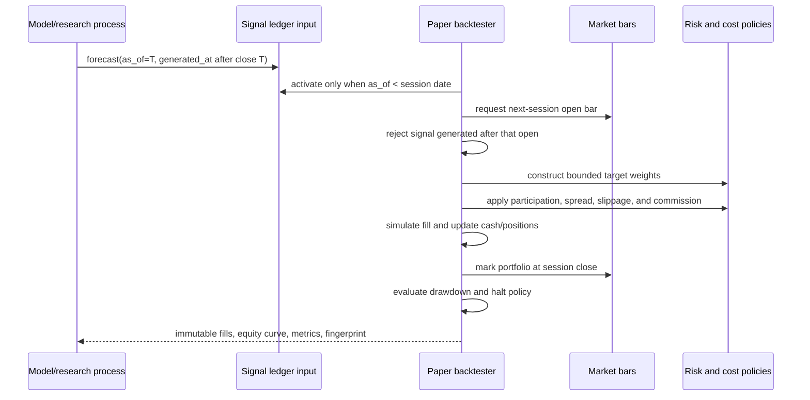

# Model Development and Paper-Backtesting Architecture

## End-to-end flow

## Holdout isolation

Candidate search, feature selection, and threshold choice must not inspect the final holdout.
The holdout report is generated only after selection is complete.

## Backtest timing

## Trust boundaries

- Dataset, split, model, and backtest fingerprints are evidence; generated IDs are not treated
  as content.
- Model plugins are trusted code loaded by configuration, not tenant-supplied executable code.
- Python/joblib deserialization is disabled by default because it can execute code.
- Backtest inputs are research records, not broker orders.
- A signal cannot execute on the same session it describes or after its permitted execution
  timestamp.
- Benchmark metrics require one benchmark bar for every simulated session.
