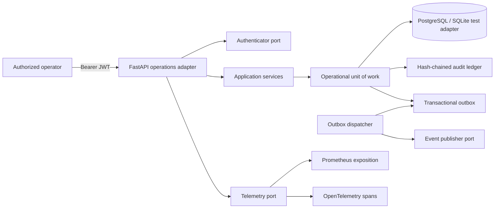
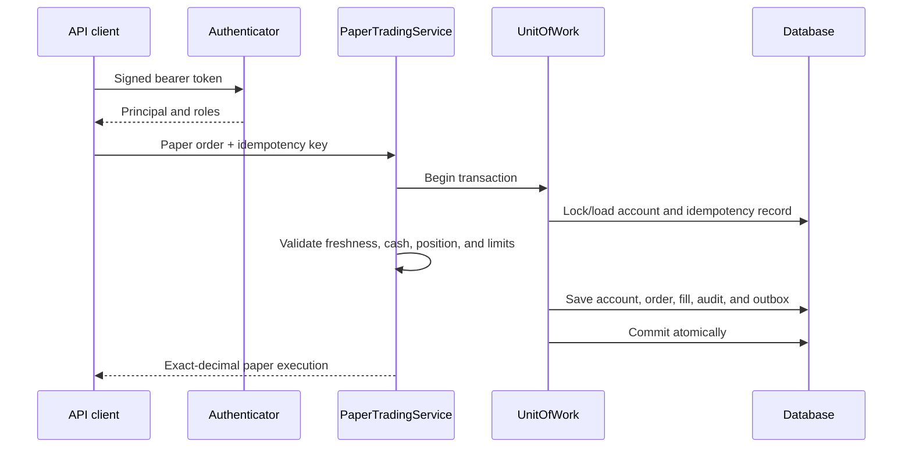

# Operations Platform Architecture

## Runtime components

## Paper-order transaction

## Trust boundaries

- The API never trusts a caller-supplied algorithm, role, owner, account balance, or execution
  result.
- JWT verification keys and database credentials are external secrets.
- The database transaction is the durability boundary for acknowledged writes.
- The event publisher is outside the transaction; the outbox bridges that boundary.
- Metrics and logs must not contain raw tokens, private keys, direct account identifiers, or
  model payloads.
