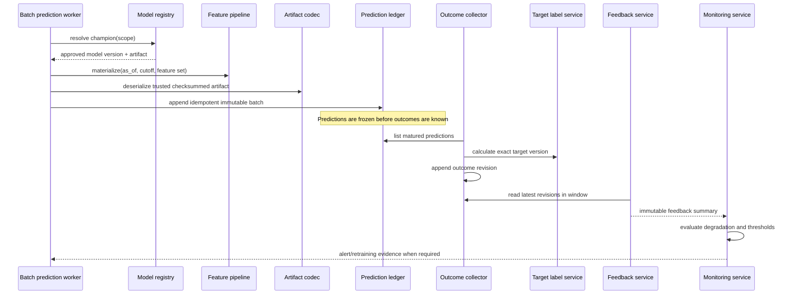
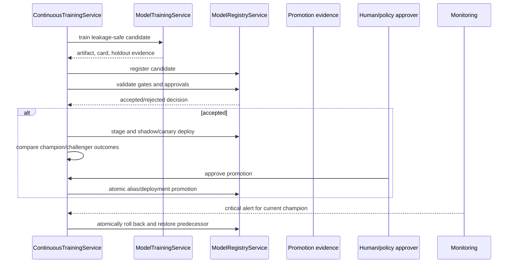

# Production MLOps Architecture — Sections 16–20

## Governed lifecycle and feedback loop

```mermaid
flowchart LR
  Artifact[Checksummed model artifact] --> Candidate[Registry candidate]
  Card[Model card and evaluation] --> Candidate
  Candidate --> Gates[Validation gates and approvals]
  Gates -->|accepted| Challenger[Shadow/canary challenger]
  Gates -->|rejected| Failed[Validation failed]
  Challenger --> Compare[Champion/challenger comparison]
  Compare -->|approved improvement| Champion[Active champion]
  Compare -->|insufficient evidence| Challenger
  Champion --> Predict[Batch inference]
  Predict --> Ledger[(Immutable prediction ledger)]
  Ledger --> Outcomes[(Versioned realized outcomes)]
  Outcomes --> Feedback[Feedback metrics]
  Feedback --> Monitor[Performance and drift monitoring]
  Monitor -->|warning/critical| Alert[(Monitoring alert)]
  Alert --> Retrain[Durable retraining request]
  Retrain --> Candidate
  Alert -->|critical champion failure| Rollback[Audited rollback]
  Rollback --> Champion
```

## Prediction-to-outcome sequence

## Promotion and rollback sequence

## Integrity rules

- Champion resolution is scoped and server-side; clients cannot select an arbitrary model.
- A prediction records the exact artifact, signature, feature snapshot, and decision cutoff.
- Prediction and outcome corrections append records rather than rewriting history.
- Drift alerts request investigation or retraining; they do not prove a challenger is better.
- Promotion and rollback are explicit registry transactions with actors, reasons, and evidence.
- No broker or live-order boundary exists.
