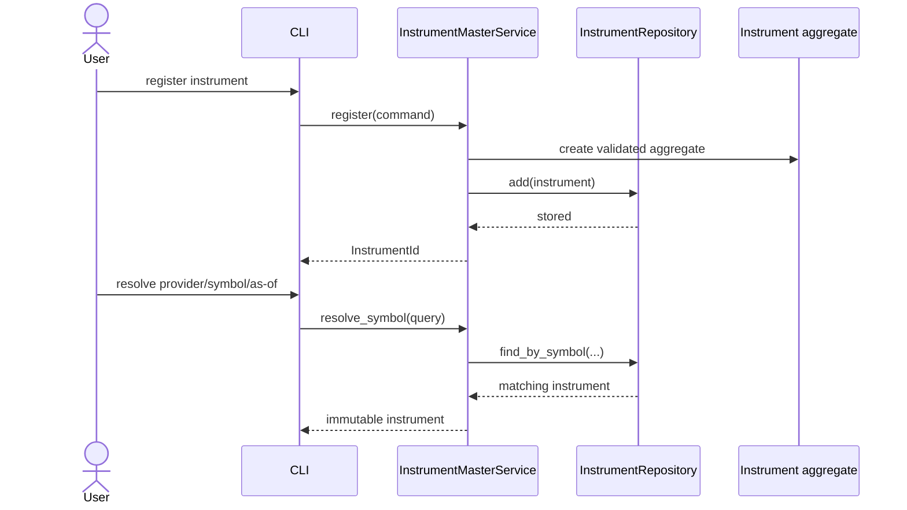
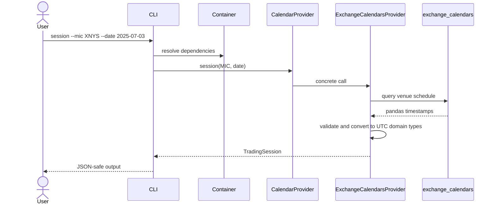
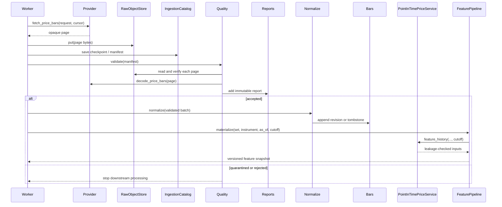
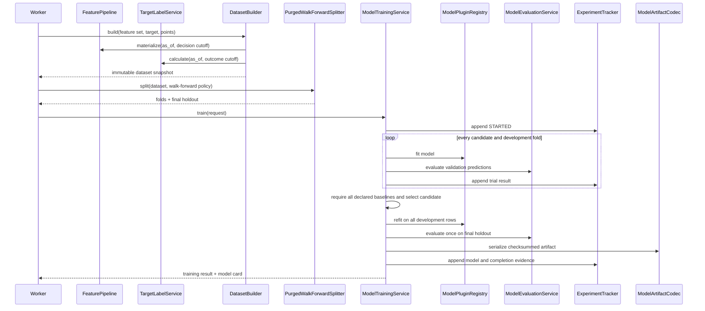
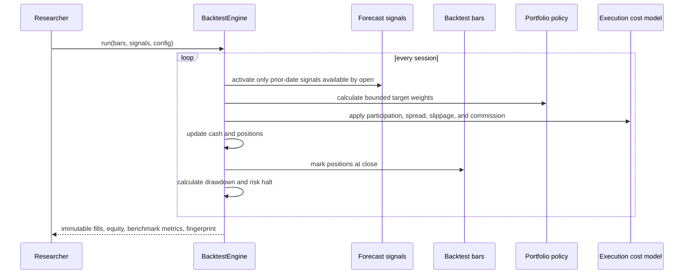
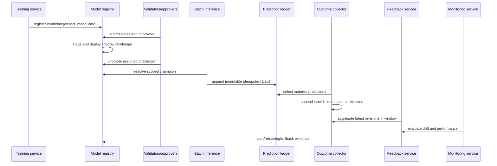
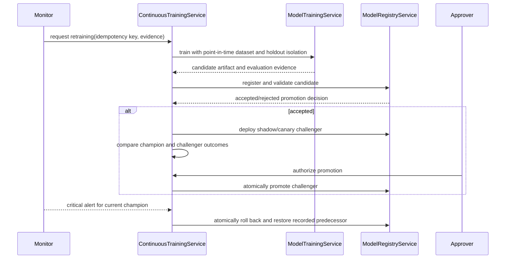
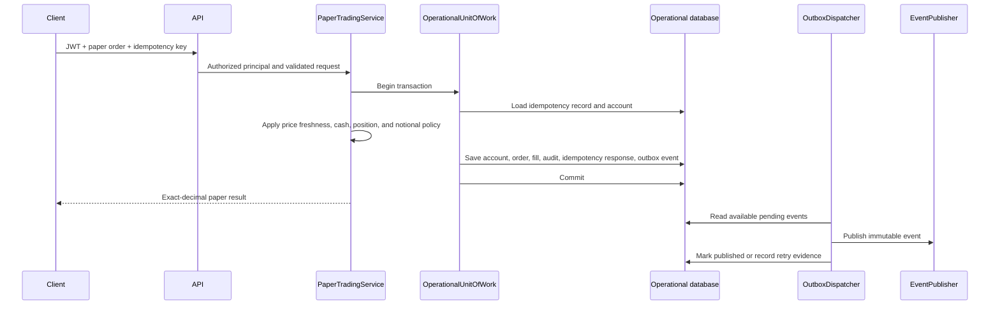

# Key Sequences

## Register and resolve a provider symbol

## Query a trading session

## Ingest, validate, normalize, and materialize features

## Build a dataset and train a governed research model

## Execute a paper backtest

## Govern a model, predict, observe outcomes, and monitor

## Controlled retraining, promotion, and rollback

## Transactional paper order and outbox publication

