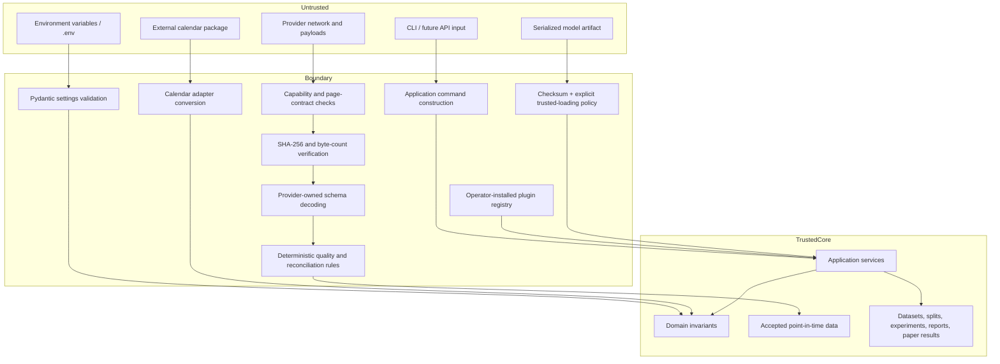

# Trust Boundaries

Rules:

- External bytes are preserved before interpretation.
- A checksum proves content identity, not truth or trust.
- Quarantined or rejected data cannot enter normalization.
- Feature and label services consume point-in-time domain inputs, not raw provider objects.
- Model plugins are trusted operator-installed code; arbitrary user-supplied code is prohibited.
- Python/joblib artifact loading is disabled by default and requires explicit trusted-source
  authorization in addition to checksum verification.
- The final holdout is not available to candidate selection.
- Backtest signals are data records, not broker orders, and cannot execute before their
  availability time.
- Secrets and credentials must never appear in payload metadata, manifests, logs, datasets,
  model cards, artifacts, feature/label lineage, or errors.
